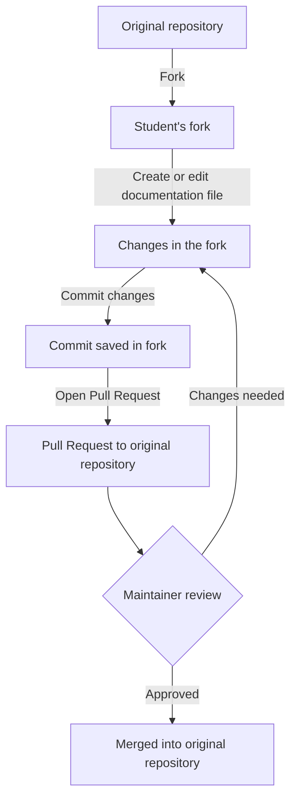

# Contributing to an Open-Source Library Management System

**Name:** ADITI ASHWIN
**USN:** NB25CSE016
**Case Study:** Question 4 - Open-Source Software Engineering

---

## 1. Introduction

Open-source software is software whose source code is open for everyone to see, use and modify. Projects like Linux, Firefox and VS Code are examples. Open-source software engineering means building and maintaining this kind of software together with a community of people, mostly using GitHub.

Contributing does not always mean writing code. A person can also fix bugs, test the software, translate it or improve the documentation.

**Why contributing to open-source projects is important**

- The project gets better because of the work of many people.
- We learn Git, GitHub and how to work in a team on a real project.
- Accepted contributions show up on our GitHub profile and help in placements.
- We get to learn from experienced developers by seeing their feedback.
- It is a way of giving something back, since we use open-source tools all the time.

## 2. Problem Analysis

A group of developers is building an open-source Library Management System on GitHub. A student notices that the project has no proper documentation on how users can issue and return books.

Because of this, new users do not know how to use the feature, and the developers may have to answer the same questions again and again. New contributors also find it hard to understand how the system works. Fixing this does not need any change in the code, only a good documentation file, so it is a good first contribution for a student.

## 3. Proposed Solution

The student will add a new documentation file called `Issue_and_Return_Books.md` to the project. This is done using the normal GitHub workflow: fork the repository, add the file, commit it and send a Pull Request.

### GitHub contribution workflow



### Step 1: Fork the repository

1. Log in to your GitHub account and open the original Library Management System repository.
2. Click the **Fork** button at the top right.
3. Choose your own account as the owner and keep the repository name the same.
4. Click **Create fork**.

Now there is a copy of the project in my own account, and I can change it without affecting the original project.

### Step 2: Create the documentation file

In my fork, I click **Add file -> Create new file** and name it `Issue_and_Return_Books.md`. The content I add is:

```markdown
# How to Issue and Return Books

## Issuing a book
1. Log in to the system as a librarian or member.
2. Search for the book using the title, author or ISBN.
3. Check that the book status is "Available".
4. Click "Issue Book" and enter the member ID.
5. Confirm. The system saves the issue date and due date.

## Returning a book
1. Open the "Issued Books" page or search by member ID.
2. Select the book that is being returned.
3. Click "Return Book".
4. The system saves the return date and adds a fine if the book is late.

## Notes
- A member can issue only a limited number of books at a time.
- Late returns may have a fine for each extra day.
```

### Step 3: Commit the changes

I click **Commit changes**, write a short message like `Added documentation for issuing and returning books`, and commit it to the main branch of my fork.

### Step 4: Submit a Pull Request

1. Go to the main page of my fork and click **Contribute -> Open pull request**.
2. Check that the base repository is the original project's `main` branch and the head repository is my fork's `main` branch.
3. Give the title `Added documentation for issuing and returning books` and write a short description of what I added.
4. Click **Create pull request**.

After this, the project maintainers review my changes. If they are fine, they merge the Pull Request and my file becomes part of the original project. If they ask for changes, I can update the file and the Pull Request gets updated automatically.

## 4. Benefits and Challenges

**Benefits of collaborative software development**

- Many people can work on the same project at the same time, so work is faster.
- Other people review the work, so mistakes are found early.
- People bring different ideas and skills.
- Git keeps a history of every change and who made it.
- The cost of development is lower because the work is shared.

**Benefits of this contribution**

- New users can learn how to issue and return books without asking anyone.
- New contributors can understand the feature quickly.
- I get practical experience with forks, commits and Pull Requests.

**Challenges**

- The maintainers may take time to review the Pull Request.
- The Pull Request can be rejected or may need changes if it does not follow the project's guidelines.
- Merge conflicts can happen if someone else edits the same file.
- Git and GitHub can be confusing for beginners at the start.

## 5. Conclusion

In this case study, the Library Management System had no documentation for issuing and returning books. The student solves this by forking the repository, creating a documentation file, committing it and sending a Pull Request to the original project. This fork, edit, commit and Pull Request process is the basic workflow of open-source contribution. It improves the project for everyone and also helps the student learn how real software teams work together.

---
