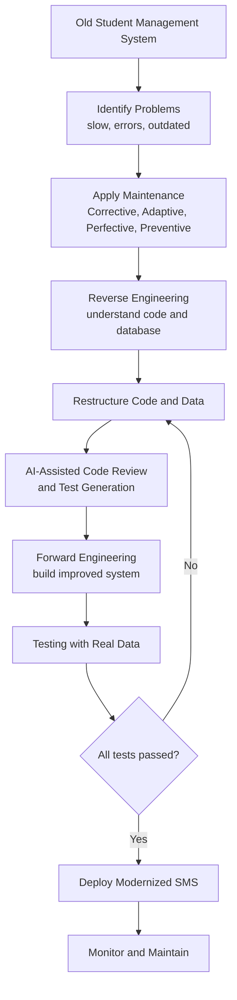

# Software Maintenance, Reengineering, and AI in Software Engineering

**Name:** AV Nikhil  
**USN:** NB25CSE001  
**Assigned Case Study:** Question 5 – Software Maintenance, Reengineering, and AI in Software Engineering

---

## 1. Introduction

Software does not stop changing once it is delivered. After deployment, bugs are found, users ask for new features, and the hardware, operating systems and browsers it runs on keep getting updated. **Software maintenance** is all the work done on a system after it is delivered to keep it correct, useful and up to date.

When a system becomes very old and hard to change, small fixes are not enough. **Software reengineering** means studying the existing system and rebuilding its structure (code, database, design) so it becomes easier to maintain, without throwing away the working logic and starting from zero.

**AI in Software Engineering** means using AI tools to help developers with tasks like finding bugs, reviewing code, generating test cases and understanding old code. These tools make maintenance and reengineering faster.

## 2. Problem Analysis

Our college has been using the same Student Management System (SMS) for many years to store student details, attendance, marks and fee records. Now it has the following problems:

| Problem | What it means for users |
|---|---|
| Slow performance | Loading a class list or marks report takes a long time, especially during exam result time when many people use it together |
| Outdated features | No mobile-friendly view, no online fee payment, reports cannot be downloaded properly |
| Frequent errors | The system crashes or shows wrong data while updating marks or attendance |
| Hard to maintain | The code is old, has very little documentation, and fixing one part sometimes breaks another part |
| Poor user experience | Faculty and students find the screens confusing and hard to use |

Since the college depends on this system every day, replacing it fully at once is risky. So the better option is to **modernize the existing system** step by step using maintenance, reengineering and AI-assisted techniques.

## 3. Proposed Solution

### 3.1 Types of Software Maintenance Suitable for the SMS

**1. Corrective Maintenance**
- Fixing bugs that are already present in the system.
- Example: fixing the error that comes when two faculty members update attendance for the same class at the same time.

**2. Adaptive Maintenance**
- Changing the system so it works in a new environment.
- Example: making it work on latest browsers and mobile phones, and moving the database to a newer server or cloud.

**3. Perfective Maintenance**
- Improving performance and adding features that users are asking for.
- Example: faster student search, downloadable PDF marks reports, online fee payment, and a cleaner dashboard.

**4. Preventive Maintenance**
- Making changes now so that problems do not happen later.
- Example: cleaning up messy code, adding proper documentation, taking regular backups and removing unused modules.

Out of these, **corrective** and **perfective** maintenance are most urgent for our college because the errors and slow speed affect people every day.

### 3.2 Steps in Software Reengineering

1. **Inventory Analysis** – List all the modules of the SMS (attendance, marks, fees, student profile) and decide which ones need reengineering first based on how often they are used and how many problems they have.
2. **Document Restructuring** – Create proper documentation for the old system since most of it is missing.
3. **Reverse Engineering** – Study the existing code and database to understand how the system actually works and recover its design.
4. **Code Restructuring** – Rewrite badly structured parts of the code into clean, smaller functions without changing what they do.
5. **Data Restructuring** – Redesign the database tables, remove duplicate data and add indexes so queries run faster.
6. **Forward Engineering** – Using the recovered design, build the improved version of the system with modern technology (for example a web interface that also works on mobile).
7. **Testing and Deployment** – Test the new system with real college data, run it alongside the old one for some time, and then fully switch over.

### 3.3 Applications of AI in Software Engineering

**1. AI-Assisted Code Analysis and Bug Detection**
- AI tools can scan the old source code and point out possible bugs, security issues and badly written code.
- They can also explain what an old, undocumented function does, which helps a lot during reverse engineering.

**2. AI-Based Test Case Generation**
- AI can automatically generate test cases for modules like marks calculation and attendance percentage.
- This makes sure that when the code is restructured, the old features still give the same correct results.

Other uses include AI code completion to speed up development and AI chatbots to help students and faculty use the system.

## 4. Benefits and Expected Improvements

1. **Better Performance** – Optimized database and cleaner code will make the system load faster, even during peak times like result announcements.
2. **Higher Reliability** – Fixing existing bugs and testing with AI-generated test cases will reduce crashes and wrong data.
3. **Easier Future Maintenance** – Clean code with proper documentation will make it easy for any developer to add new features later.
4. **Improved User Experience** – A modern, mobile-friendly interface will be easier for students and faculty to use.
5. **Lower Cost** – Modernizing the existing system is cheaper and less risky than building a completely new one.

## 5. Modernization Workflow Diagram

## 6. Conclusion

Every software system needs maintenance throughout its life, and old systems like our college's Student Management System eventually need reengineering to stay useful. By using the right types of maintenance, following proper reengineering steps, and using AI tools for code analysis and testing, the college can turn its slow and error-prone system into a fast, reliable and easy-to-maintain one, without the cost and risk of building a new system from scratch.
