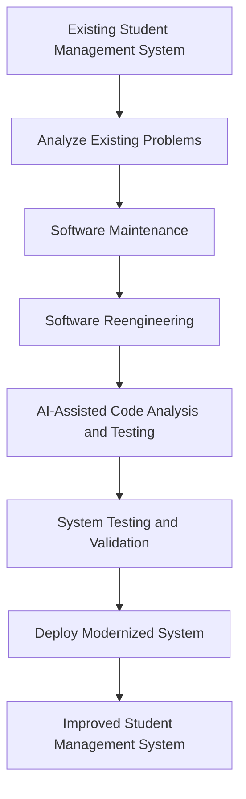

# Software Maintenance, Reengineering, and AI in Software Engineering

Student Name: Aarohi Agrawal  
USN: NB25CSE005  
Case Study: Question 5 – Software Maintenance, Reengineering, and AI in Software Engineering

## 1. Introduction to Software Maintenance

Software maintenance is the process of modifying and updating software after its development to improve its performance, fix errors, and meet changing user requirements.
It helps software remain reliable, secure, efficient, and useful over a long period.
Software reengineering involves examining and modifying an existing software system to improve its structure, functionality, and quality without developing an entirely new system.
AI-assisted software engineering uses Artificial Intelligence tools and techniques to help developers identify errors, improve code quality, automate testing, and make software development more efficient.

## 2. Problem Analysis

The college has been using a Student Management System for several years. Over time, the system has developed several problems:

- Slow Performance: The system takes more time to process requests and retrieve student information.
- Outdated Features: Some existing features no longer satisfy the current requirements of the college.
- Frequent Errors: The system produces errors during operations, affecting its reliability.
- Difficult Maintenance: The old software structure makes modifications and updates difficult.
- Poor Efficiency:The system does not provide the expected performance and user experience.

Therefore, the college needs to modernize the existing system using software maintenance, reengineering, and AI-assisted techniques.

 ## 3. Proposed Solution

The existing Student Management System can be improved using the following approaches:

### A. Suitable Types of Software Maintenance

1. **Corrective Maintenance:** Fixing errors and bugs in the existing system to improve its reliability.
2. **Adaptive Maintenance:** Updating the software to work with new technologies, operating systems, and changing college requirements.
3. **Perfective Maintenance:** Improving existing features, system performance, and user experience according to user needs.
4. **Preventive Maintenance:** Modifying the software to reduce future errors and make it easier to maintain.

### B. Steps Involved in Software Reengineering

Software reengineering can be performed through the following steps:

1. **Analysis of Existing System:** Study the current system and identify performance issues, outdated features, and errors.
2. **Code Analysis:** Examine the existing source code to understand its structure and identify areas that need improvement.
3. **Code Restructuring:** Organize and modify the existing code to make it simpler, cleaner, and easier to maintain.
4. **Database Improvement:** Review and improve the database structure to support efficient storage and retrieval of student information.
5. **System Testing:** Test the modified system to ensure that errors are fixed and existing functionalities work correctly.
6. **Deployment:** Implement the improved system for college use and monitor its performance.

### C. Applications of AI in Software Engineering

Artificial Intelligence can help modernize the Student Management System in the following ways:

  1. **AI-Based Bug Detection and Code Analysis**
     AI tools can analyze source code, identify possible errors, detect coding issues, and suggest improvements. This helps
     developers improve code quality and reduce debugging time.

  2. **AI-Assisted Software Testing**
     AI can help generate test cases, identify potential failures, and automate repetitive testing activities. This helps
     developers detect errors and improve the reliability of the system.

## 4. Benefits and Expected Improvements

The implementation of software maintenance, reengineering, and AI-assisted techniques can provide the following improvements:

1. **Improved Performance:** Optimizing the existing system helps reduce processing time and makes operations faster.
2. **Better Reliability:** Identifying and fixing errors improves system stability and reduces failures.
3. **Easy Maintenance and Future Updates:** Restructuring the code and using AI-assisted tools makes the system easier to maintain, test, and upgrade.

## 5. Modernization Workflow Diagram

The following diagram represents the process of modernizing the existing Student Management System.

## 6. Conclusion

Software maintenance, reengineering, and AI-assisted techniques play an important role in modernizing existing software systems.
By applying suitable maintenance methods, restructuring the existing system, and using AI tools for code analysis and testing, the 
college can improve the performance, reliability, and efficiency of its Student Management System.
Thus, modernizing the existing system provides a better experience for students, faculty members, and administrators while 
making future updates easier.
