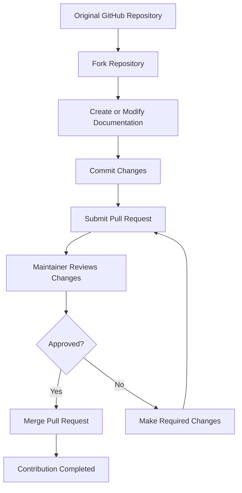

# Open-Source Software Engineering

## Improving Documentation of a Library Management System

### Student Details

- **Name:** Adithya .
- **USN:** NB25CSE013
- **Case Study:** Question 4 – Open-Source Software Engineering

## 1. Introduction

Open-Source Software Engineering is a software development approach in which the source code of a software application is publicly available. Developers can access, study, modify, improve and distribute the software according to its licence.

Platforms like GitHub support open-source development by allowing developers to collaborate using repositories, branches, commits, forks and pull requests.

In this case study, a student identifies that an open-source Library Management System lacks proper documentation explaining how users can issue and return books. The student contributes by creating or improving the documentation and submitting the changes to the original repository for review.

## 2. Problem Analysis

The existing Library Management System does not contain sufficient documentation explaining the book issuing and returning procedures.

This creates several problems:

- New users may find it difficult to understand the system.
- Users may not know the correct procedure for issuing books.
- The book return process may be confusing.
- Developers may spend additional time answering common questions.
- Lack of documentation affects the usability and maintainability of the project.

Therefore, improving the documentation is necessary to make the application easier to understand and use.

## 3. Proposed Solution

The student can contribute to the open-source project by creating a documentation file containing clear instructions for issuing and returning books.

### Step 1: Fork the Repository

- Open the original Library Management System repository on GitHub.
- Click the Fork option.
- Select the student's GitHub account as the owner.
- Create a copy of the repository under the student's account.

Forking creates an independent copy of the original repository where the student can make changes.

### Step 2: Create or Modify Documentation

- Open the forked repository.
- Navigate to the contributions folder.
- Create a new Markdown file named `Book_Issue_Return_Guide.md`.
- Add instructions explaining the book issuing and returning procedures.

**Book Issuing Procedure:**

1. Log in to the Library Management System.
2. Search for the required book using its title or book ID.
3. Check the availability of the book.
4. Select the issue option.
5. Confirm the issue transaction.
6. Note the due date for returning the book.

**Book Returning Procedure:**

1. Log in to the system.
2. Navigate to the issued books section.
3. Select the book to be returned.
4. Click the return option.
5. Confirm the return transaction.
6. Check whether any overdue fine is applicable.

### Step 3: Commit the Changes

- Review the content for spelling and formatting errors.
- Save the Markdown file.
- Click Commit changes.
- Enter a meaningful commit message such as `Added book issue and return documentation`.
- Commit the changes to the main branch of the student's fork.

A commit records the changes made to the repository.

### Step 4: Submit a Pull Request

- Open the student's forked repository.
- Navigate to the Pull Requests section.
- Click New Pull Request.
- Select the original repository as the base repository.
- Select the student's fork as the head repository.
- Verify that the changes are correct.
- Enter a suitable title and description.
- Click Create Pull Request.

A Pull Request allows the original project maintainers to review the proposed contribution.

### Step 5: Review and Merge

The project maintainer reviews the submitted documentation.

If the contribution meets the project requirements, the maintainer approves and merges the Pull Request into the original repository.

The improved documentation then becomes part of the main project.

## 4. Benefits of Open-Source Contributions

1. **Knowledge Sharing:** Developers can share their knowledge and learn from other contributors.
2. **Improved Software Quality:** Contributions help improve the functionality, usability and documentation of software.
3. **Collaboration:** Developers from different locations can work together on a common project.
4. **Skill Development:** Students gain practical experience with Git, GitHub and software development workflows.
5. **Community Support:** Open-source projects benefit from feedback and contributions from a larger developer community.

## 5. Challenges

1. **Understanding Existing Code:** New contributors may find it difficult to understand the structure and guidelines of an existing project.
2. **Code and Documentation Standards:** Contributions must follow the formatting and documentation standards established by project maintainers.
3. **Pull Request Review:** Changes may require modifications before they are accepted and merged.

## 6. GitHub Contribution Workflow

The following workflow represents the process of contributing to an open-source project:

## 7. Conclusion

Open-Source Software Engineering encourages collaboration, knowledge sharing and continuous improvement of software applications.

In this case study, the student contributes to a Library Management System by improving its documentation for issuing and returning books. Using GitHub features such as Fork, Commit and Pull Request, the student can contribute changes to an existing project in a structured manner.

This activity provides practical experience in collaborative software development and helps students understand how real-world open-source projects are maintained and improved.
