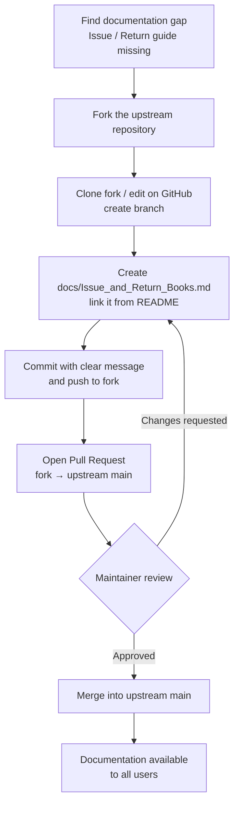

# Open-Source Software Engineering – Improving Documentation of a Library Management System

| Field | Details |
|---|---|
| **Name** | Aditya B Rabb |
| **USN** | NB25CSE019 |
| **Assigned Case Study** | Question 4 – Open-Source Software Engineering |

---

## 1. Introduction

**Open-Source Software (OSS)** is software whose source code is publicly available, so anyone can read, use, modify and redistribute it under an open licence (for example MIT, Apache 2.0 or GPL).

**Open-source software engineering** is the practice of building such software collaboratively. Developers from different places work on one shared codebase, usually hosted on a platform like **GitHub**, and use **version control (Git)**, **issues**, **forks** and **Pull Requests (PRs)** to propose, review and merge changes.

Well-known examples: Linux, Python, VS Code, Firefox and Kubernetes.

## 2. Problem Analysis

A group of developers maintains an open-source **Library Management System (LMS)** on GitHub. The code works, but the project has a documentation gap:

| Problem | Effect |
|---|---|
| No guide explaining how a user **issues** a book | New librarians cannot use the feature without reading the code |
| No guide explaining how a user **returns** a book | Fine calculation and return rules are unclear |
| README describes only installation | Users raise repeated "how do I…?" issues, wasting maintainers' time |
| No examples or screenshots | New contributors cannot understand the workflow quickly |

Documentation is part of the software. Missing documentation lowers **usability** and **maintainability** and discourages new contributors.

## 3. Importance of Contributing to Open-Source Projects

1. **Real-world experience** – students work on real codebases, real reviews and real Git workflows.
2. **Improves the software for everyone** – one fix or guide helps every user of the project.
3. **Builds a public portfolio** – merged PRs on GitHub act as proof of skill for recruiters.
4. **Learning from reviewers** – maintainers' feedback teaches coding standards and best practices.
5. **Community and collaboration** – contributors learn teamwork, communication and code etiquette.
6. **Documentation is an easy first contribution** – it needs no deep knowledge of the code, so it is the ideal entry point for beginners.

## 4. Proposed Solution – Contributing Documentation Through the GitHub Workflow

The student will add a new file `docs/Issue_and_Return_Books.md` to the LMS project and submit it to the maintainers using the **fork → edit → commit → Pull Request** workflow.

### 4.1 Steps to Fork the Repository

1. Sign in to GitHub with your own account.
2. Open the original (upstream) repository, e.g. `https://github.com/<maintainer>/Library-Management-System`.
3. Click **Fork** (top-right).
4. Keep yourself as the **Owner** and the repository name unchanged; tick **Copy the main branch only**.
5. Click **Create fork**.
6. GitHub now shows `<your-username>/Library-Management-System`, **forked from** `<maintainer>/Library-Management-System`.

A **fork** is your own server-side copy of the project. You can change it freely without affecting the original.

*(Optional – working locally)*

```bash
git clone https://github.com/<your-username>/Library-Management-System.git
cd Library-Management-System
git checkout -b docs/issue-return-guide      # work on a separate branch
```

### 4.2 Creating or Modifying a Documentation File

In the fork: **Add file → Create new file**, filename `docs/Issue_and_Return_Books.md`, with content like:

```markdown
# How to Issue and Return Books

## Issuing a Book
1. Log in as Librarian.
2. Go to **Transactions → Issue Book**.
3. Enter the Member ID and the Book ID (or scan the barcode).
4. The system checks that the book is available and the member
   has not crossed the borrowing limit (3 books).
5. Click **Issue**. The due date is set to 14 days from today.

## Returning a Book
1. Go to **Transactions → Return Book**.
2. Enter or scan the Book ID.
3. The system shows the issue date and due date.
4. If returned late, a fine of ₹2 per day is calculated automatically.
5. Collect the fine (if any) and click **Return**. The book becomes available again.

## Common Errors
| Message | Meaning | Fix |
|---|---|---|
| Book not available | Already issued | Reserve it instead |
| Limit reached | Member already has 3 books | Return a book first |
```

The student should also add a link to this guide in the main `README.md` so users can find it.

### 4.3 Committing the Changes

1. Click **Commit changes**.
2. Write a clear, meaningful commit message, e.g.
   `docs: add guide for issuing and returning books`
3. Commit to the fork's branch (`main`, or the separate `docs/issue-return-guide` branch).

Command-line equivalent:

```bash
git add docs/Issue_and_Return_Books.md README.md
git commit -m "docs: add guide for issuing and returning books"
git push origin docs/issue-return-guide
```

### 4.4 Submitting a Pull Request

1. Open your fork and click **Contribute → Open pull request**.
2. Check the settings:

| Setting | Value |
|---|---|
| Base repository | `<maintainer>/Library-Management-System` |
| Base branch | `main` |
| Head repository | `<your-username>/Library-Management-System` |
| Compare branch | `main` / `docs/issue-return-guide` |

3. Title: **Add documentation for issuing and returning books**.
4. Description: what was added, why it is needed, and which issue it fixes (e.g. `Closes #12`).
5. Click **Create pull request**.
6. Maintainers review the **Files changed** tab, may request changes, and finally click **Merge pull request**. The guide is now part of the official project.

### 4.5 GitHub Contribution Workflow Diagram



Text version (if the diagram does not render):

```
 Find gap ─► Fork repo ─► Create branch ─► Add/edit .md file ─► Commit & push
                                                  ▲                    │
                                                  │                    ▼
                                       Changes requested ◄── Open Pull Request
                                                                       │
                                                               Review approved
                                                                       ▼
                                                    Merge ─► Docs live for all users
```

## 5. Benefits and Challenges

### Benefits of Collaborative Software Development

| Benefit | Explanation |
|---|---|
| **Better quality** | Peer review of every PR catches mistakes before they are merged |
| **Faster development** | Many contributors work in parallel on separate forks/branches |
| **Shared knowledge** | Good documentation lets new users and developers get started quickly |
| **Transparency** | Every change is tracked in Git history with author and reason |
| **Safe experimentation** | Forks and branches keep the main project stable |
| **Community growth** | Easy first contributions (like docs) attract new contributors |

### Challenges

- **Review delays** – maintainers are often volunteers, so PRs may wait for days.
- **Merge conflicts** – the upstream project may change while you work; the fork must be kept in sync (`git fetch upstream` / **Sync fork**).
- **Following project rules** – each project has its own contribution guidelines, style and licence that must be respected.
- **Keeping docs up to date** – if the issue/return feature changes, the guide must be updated too.

## 6. Conclusion

The Library Management System lacked documentation on issuing and returning books, which made it hard to use. By **forking** the repository, **adding a Markdown guide**, **committing** with a clear message and **submitting a Pull Request**, a student can fix this gap without needing write access to the original project. The maintainers review and merge the change, and every user benefits. This fork-and-pull-request workflow is the foundation of open-source software engineering: it allows many people to improve one project safely, transparently and collaboratively.

---

*Submitted as part of the SEA Open-Source Contribution activity – NB25CSE019.*
