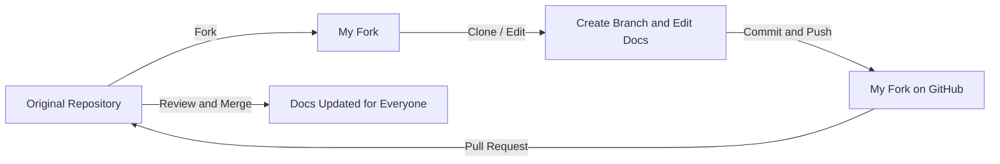

# Contributing to Open Source: Improving Library Management System Documentation

**Name:** Allen Chathuruthy
**USN:** NB25CSE026
**Assigned Case Study:** Question 4 – Open-Source Software Engineering

---

## 1. Introduction

**Open-source software** is software whose source code is public. Anyone can read it, use it, suggest changes and improve it, under a license. **Open-source software engineering** is building such software collaboratively, with contributors from all over the world working through platforms like GitHub. Examples: Linux, Python and VS Code.

### Why Contributing Matters

- You **learn real-world workflows** such as Git, code review and teamwork.
- You **build a public portfolio** that helps with placements.
- You **improve software** that many people use.
- You **get feedback** from experienced developers.
- Documentation contributions are a **good first step**, because you don't need to change any code.

## 2. Problem Analysis

An open-source **Library Management System** on GitHub has no clear documentation explaining how users can **issue and return books**. New users are confused and may stop using the project. The student can fix this by adding a documentation file.

## 3. Proposed Solution

### GitHub Workflow

1. **Fork** the repository. Click *Fork* on the project page. This creates your own copy under your account.
2. **Clone** (optional) or edit directly on GitHub. To work locally: `git clone https://github.com/YOUR-USERNAME/library-management-system.git`
3. **Create a branch**: `git checkout -b docs-issue-return-books`
4. **Create or modify a documentation file**, for example `docs/ISSUE_AND_RETURN_BOOKS.md`.
5. **Commit** the change with a clear message: `git add .` then `git commit -m "Added documentation for issuing and returning books"`
6. **Push** to your fork: `git push origin docs-issue-return-books`
7. **Open a Pull Request** from your fork's branch to the original repository's `main` branch. Write a clear title and description.
8. **Review and merge** – the maintainer reviews it, may ask for changes, and then merges it.

### Example Documentation File

```markdown
# How to Issue and Return Books

## Issue a Book
1. Log in as a librarian.
2. Open **Issue Book** from the menu.
3. Enter the Student ID and Book ID.
4. Click **Issue**. The due date is set automatically.

## Return a Book
1. Open **Return Book** from the menu.
2. Enter the Book ID.
3. Click **Return**. Any fine is calculated and shown.
```

### GitHub Contribution Workflow Diagram



## 4. Benefits and Challenges

### Benefits of Collaborative Software Development

- Many people review the work, so quality improves.
- Knowledge and skills are shared.
- Projects improve faster and stay maintained.
- Contributors gain experience and recognition.

### Challenges

- Following the project's contribution rules and style.
- Maintainers may take time to review, or ask for changes.
- Merge conflicts if the original project changed meanwhile (fixed by syncing the fork).

## 5. Conclusion

By forking the repository, adding a clear documentation file and submitting a Pull Request, a student can make a real contribution without writing code. This workflow of fork, branch, commit, push and Pull Request is the standard way open-source projects grow, and it builds useful skills for a software career.
