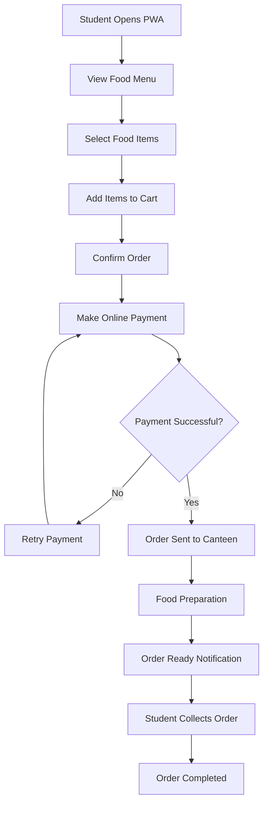

# Mobile and Web Applications Engineering
## Online College Canteen Food-Ordering System

**Student Name:** Amruta Pandey  
**USN:** NB25CSE034  
**Assigned Case Study:** Question 2-Mobile and Web Applications Engineering

---

## 1. Introduction

Mobile and web applications are software applications designed to provide services to users through different devices and platforms.

A mobile application is developed specifically for mobile devices such as smartphones and tablets. It can be downloaded and installed from application stores. A web application runs through a web browser and does not usually require installation. A Progressive Web Application (PWA) combines features of both mobile and web applications by providing an app-like experience through a browser.

In the proposed college canteen food-ordering system, students should be able to view food menus, place orders, make payments, and receive notifications when their orders are ready.

## 2. Problem Analysis

The traditional college canteen ordering process often involves students standing in queues to check menus, place orders, and collect food. During peak hours, this can lead to overcrowding, delays, and inconvenience.

The major problems include:

- Long waiting times during lunch breaks.
- Difficulty in checking available food items and prices.
- Manual order management by canteen staff.
- Delays and errors in handling multiple orders.
- Lack of proper order status updates.

Therefore, a digital food-ordering application is required to simplify the ordering process and improve the overall canteen experience.

## 3. Comparison of Mobile, Web, and Progressive Web Applications

### 3.1 Mobile Application

A mobile application is designed specifically for smartphones and tablets. It is installed on the device and can use features such as notifications, camera, and device storage.

**Advantages:**
- Provides a user-friendly mobile experience.
- Supports push notifications.
- Can access device-specific features.
- Can offer offline functionality for certain operations.

**Limitations:**
- Requires installation.
- Separate development may be needed for different operating systems.
- Application updates may require users to download new versions.

### 3.2 Web Application

A web application runs through a web browser and can be accessed using a URL.

**Advantages:**
- No installation is required.
- Accessible from different devices.
- Updates can be made centrally.
- Easier to maintain a single application.

**Limitations:**
- Requires an internet connection for most operations.
- Some device-specific features may be limited.
- Browser compatibility needs to be considered.

### 3.3 Progressive Web Application (PWA)

A Progressive Web Application combines the advantages of web and mobile applications. It runs through a browser but can also be installed on a device and provide an app-like experience.

**Advantages:**
- Can be accessed through a web browser.
- Can be installed on supported devices.
- Supports push notifications on supported platforms.
- Can provide offline access to selected content using service workers.
- Does not require traditional application store installation.

**Limitations:**
- Some device features may not be fully supported across all browsers.
- Offline functionality requires additional development.
- Browser and operating system compatibility must be considered.

### 3.4 Comparison Table

| Feature | Mobile App | Web App | PWA |
|---|---|---|---|
| Installation | Required | Not required | Optional |
| Accessibility | Installed devices | Web browsers | Browser and installed devices |
| Updates | App updates | Centralized | Centralized |
| Notifications | Supported | Browser-dependent | Supported on compatible platforms |
| Offline Access | Possible | Limited | Possible using service workers |
| Development | Platform-specific options | Browser-based | Web technologies |

## 4. Selection of a Suitable Application

For the proposed college canteen food-ordering system, a **Progressive Web Application (PWA)** is the most suitable choice.

A PWA provides the accessibility of a web application along with several features of a mobile application. Students can open the system directly through a browser without installing additional software. Those who prefer an app-like experience can install it on supported devices.

The main reasons for selecting a PWA are:

1. **Easy Accessibility:** Students can access the canteen system through a URL on smartphones, tablets, and computers.
2. **No Mandatory Installation:** Students do not need to download a separate application.
3. **Push Notifications:** Students can receive notifications about order confirmation and food readiness on supported platforms.
4. **Cost-Effective Development:** A single codebase can serve multiple types of devices.
5. **Offline Support:** Previously loaded menu information can be made available offline using service workers.

Thus, a PWA provides a practical and convenient solution for a college canteen environment.

## 5. Major Functionalities

The proposed canteen food-ordering application should include the following functionalities:

### 5.1 Menu Browsing

- Display available food items with names, images, and prices.
- Organize food items into categories such as snacks, beverages, and meals.
- Show item availability.
- Allow students to view menu details before ordering.

### 5.2 Online Food Ordering

- Allow students to select food items.
- Provide an option to add or remove items from the cart.
- Calculate the total order amount automatically.
- Allow students to confirm their orders.

### 5.3 Online Payment

- Support digital payment methods through a secure payment gateway.
- Display the total amount before payment.
- Generate payment confirmation after a successful transaction.
- Maintain payment and order records.

### 5.4 Order Tracking and Notifications

- Display the current order status.
- Notify students when their orders are confirmed.
- Update students when food preparation is completed.
- Send notifications when orders are ready for collection.

## 6. Development Challenges

The development of the proposed application may involve the following challenges:

### 6.1 Payment Security

The application must ensure secure payment processing and protect students' financial information. Integration with a reliable payment gateway and secure communication protocols is necessary.

### 6.2 High User Traffic

During lunch breaks, many students may access the application simultaneously. The system should handle multiple users and orders without becoming slow or unavailable.

### 6.3 Browser and Device Compatibility

The PWA should work consistently across different browsers, smartphones, tablets, and operating systems. Developers must test the application on multiple platforms to ensure proper functionality.

## 7. Application Workflow Diagram

The following diagram represents the working process of the proposed college canteen food-ordering application.

### Working Explanation

1. The student opens the PWA using a browser or an installed shortcut.
2. The application displays the available food menu.
3. The student selects food items and adds them to the cart.
4. The student confirms the order and proceeds to payment.
5. After successful payment, the order details are sent to the canteen.
6. Canteen staff prepare the selected food items.
7. The application sends a notification when the order is ready.
8. The student collects the order from the canteen.

## 8. Benefits of the Proposed System

The proposed PWA-based canteen ordering system provides several benefits:

- **Reduced Waiting Time:** Students can place orders before reaching the canteen.
- **Convenience:** Food menus and prices are available digitally.
- **Improved Order Management:** Canteen staff can manage incoming orders more efficiently.
- **Better Communication:** Order status notifications keep students informed.
- **Accessibility:** Students can use the system across different devices.

## 9. Conclusion

Mobile and web application technologies provide effective ways to develop digital services for educational institutions. In the proposed college canteen food-ordering system, a Progressive Web Application is a suitable solution because it combines easy browser access, optional installation, and app-like functionality.

The system allows students to browse menus, place orders, make online payments, and receive notifications when their food is ready. Although challenges such as payment security, high user traffic, and device compatibility must be addressed, the proposed solution can improve the efficiency of canteen operations and provide a convenient experience for students.

Therefore, implementing a PWA-based food-ordering system can reduce waiting times, simplify order management, and modernize the college canteen experience.