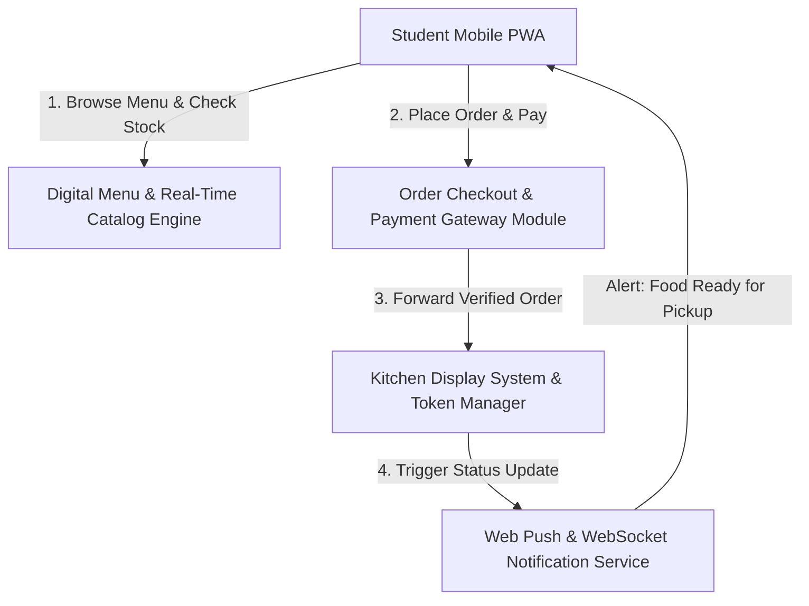
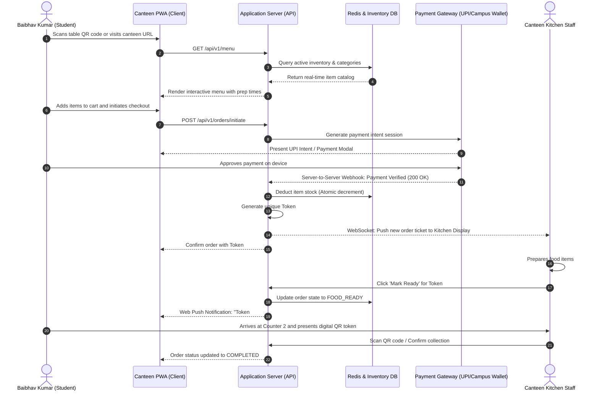

# Case Study 2: Online Canteen Food-Ordering System
### Domain: Mobile and Web Applications Engineering

---

## 1. Student and Assignment Details
- **Student Name:** Baibhav Kumar
- **USN:** NB25CSE060
- **Course / Subject:** Software Engineering & Architecture (SEA)
- **Assigned Case Study:** Question 2 – Mobile and Web Applications Engineering
- **GitHub Target Filename:** `NB25CSE060_Canteen_Application.md`
- **Target Repository Directory:** `contributions/`

---

## 2. Introduction
In modern software engineering, client-facing applications can be deployed through three primary architectural models: **Native Mobile Applications**, **Traditional Web Applications**, and **Progressive Web Applications (PWAs)**. Each paradigm represents distinct trade-offs between hardware access, cross-platform reach, development costs, update life cycles, and storage constraints:

1. **Native Mobile Applications:** Engineered specifically for target operating systems (Android via Kotlin/Java or iOS via Swift). They deliver high graphics performance and deep hardware access (biometrics, camera, Bluetooth, system-level background processes), but require separate platform codebases, app store review cycles (Google Play, Apple App Store), and substantial device storage.
2. **Traditional Web Applications:** Centralized client-server applications delivered over HTTP/HTTPS and executed inside standard desktop or mobile web browsers (using HTML5, CSS3, JavaScript/TypeScript, and frameworks such as React or Angular). They run ubiquitously across platforms without installation, but traditionally cannot function offline or deliver reliable mobile push notifications.
3. **Progressive Web Applications (PWAs):** Web applications enhanced with modern browser standards including **Service Workers**, **Web App Manifests**, **Cache Storage API**, and **Web Push Notifications**. A PWA operates as an app-like system directly from a browser URL, supports home screen installation without app stores, operates smoothly in offline or low-connectivity environments, and uses a single unified codebase.

---

## 3. Problem Analysis
The college canteen currently relies on traditional manual ordering and physical cash or paper token counters. During peak intervals (such as the 30-minute mid-morning break and lunch rush), over 500 students converge simultaneously on the cafeteria, exposing multiple operational bottlenecks:

- **Severe Queue Bottlenecks:** Students spend 15 to 25 minutes standing in physical lines merely to view the menu, place orders, and pay, leaving minimal time to eat.
- **Stock Discrepancies and Order Cancellations:** Kitchen staff frequently run out of popular dishes without real-time inventory updates reaching the billing counter, resulting in customer frustration, manual refunds, and order confusion.
- **Manual Payment Delays:** Processing paper currency or verifying individual UPI transaction screenshots at the billing register creates long queues.
- **Disorganized Food Pickup:** Without visibility into kitchen preparation stages, students crowd around the food collection counters asking staff about their order status.

### System Objectives
The institution requires an **Online Canteen Food-Ordering System** enabling students to:
1. Browse real-time menus and check food availability remotely from classrooms or hostels.
2. Place customized orders and execute instant, cashless digital payments.
3. Receive automated notifications and dynamic digital tokens when food is ready for counter pickup.

---

## 4. Architectural Comparison and Selection

### 4.1 Comparative Analysis

| Evaluation Criteria | Native Mobile Application | Traditional Web Application | Progressive Web Application (PWA) |
| :--- | :--- | :--- | :--- |
| **Onboarding Friction** | High (search app store, download 40–100MB, configure permissions) | Low (open browser link) | **Lowest (scan QR code on cafeteria table, instant 2-second access)** |
| **Cross-Platform Compatibility** | Low (separate iOS & Android builds or complex multi-target frameworks) | High (runs on any modern browser) | **Highest (single responsive codebase runs on Android, iOS, Windows, macOS)** |
| **Device Storage Footprint** | Heavy (50MB – 150MB of local storage) | Negligible (temporary browser cache) | **Ultra-Lightweight (< 3MB to 5MB cached assets)** |
| **Push Notification Capability** | Native OS background push notifications | Not supported on mobile web browsers | **Supported via Web Push API and background Service Workers** |
| **Offline / Spotty Network Support** | Full offline support via local database | Fails completely on network disconnection | **High (offline UI shell caching via Cache API and background sync)** |
| **Release & Update Cycle** | Slow (requires app store approval: 24–72 hours) | Instant server-side deployment | **Instant (automatic Service Worker cache update upon deployment)** |
| **Development & Maintenance Cost** | High (dual platform engineering teams) | Moderate (single frontend/backend team) | **Optimal (single unified JavaScript/TypeScript tech stack)** |

### 4.2 Architectural Selection and Justification
**Selected Architecture:** **Progressive Web Application (PWA) with a Mobile-First Responsive Interface.**

#### Justification for the College Environment:
1. **Elimination of User Adoption Friction:** College students carry devices with varying hardware capabilities and limited storage. Mandating an app store download for a canteen meal creates unnecessary friction. With a PWA, students scan a QR code placed on classroom desks, canteen tables, or notice boards to immediately access the menu.
2. **Push Notifications for Food Readiness:** Through the **W3C Web Push API** and background Service Workers, the PWA sends audible and visual alerts (e.g., *"Token #42 is ready at Counter 2!"*) to the student’s device even when the browser tab is closed.
3. **Resilience to Spotty Campus Wi-Fi:** College cafeteria basements frequently suffer from cell signal degradation and Wi-Fi congestion. The PWA caches application assets (HTML/CSS/JS bundles and static images) locally using the **Cache Storage API**, allowing menu browsing and order history access even during temporary signal drops.
4. **Single Codebase Efficiency:** The entire system (student ordering interface, kitchen display dashboard, and administrative console) can be developed and maintained using a single modern full-stack web repository (e.g., Next.js/React, Tailwind CSS, and Node.js), maximizing development agility.

---

## 5. Major Functionalities of the Proposed Solution

The system incorporates four core functional modules designed for high throughput and reliability:



### 1. Digital Menu Browsing and Real-Time Inventory Catalog
- **Categorized Menu Display:** Dynamic filtering by meal categories (Breakfast, Lunch, Snacks, Beverages) and dietary tags (Veg, Non-Veg, Vegan, Jain).
- **Live Stock Synchronization:** Real-time inventory tracking connected via WebSockets that instantly marks items as *"Sold Out"* or *"Limited Quantity"* when kitchen thresholds are reached.
- **Dynamic Preparation Time Estimates:** Displays calculated wait times based on active kitchen load (e.g., *"Estimated preparation: 8–10 minutes"*).

### 2. Cart Management, Order Placement, and Secure Digital Payments
- **Dynamic Cart and Customization:** Enables students to select portion sizes and provide dietary notes (e.g., *"Less spice"*, *"No sugar"*).
- **Multi-Rail Payment Integration:** Integrated with UPI deep linking (Google Pay, PhonePe, Paytm), debit/credit cards, and college campus RFID smart card wallets.
- **Cryptographic Token Generation:** Generates a secure, tamper-proof digital order token containing a unique QR verification code upon payment confirmation.

### 3. Kitchen Display System (KDS) and Queue Processing
- **Staff Touch Dashboard:** Web-based tablet interface deployed at kitchen preparation stations.
- **Deterministic State Machine:** Orders transition smoothly through defined operational states:
  $$\text{ORDER\_PLACED} \longrightarrow \text{IN\_PREPARATION} \longrightarrow \text{FOOD\_READY} \longrightarrow \text{COLLECTED}$$
- **Workstation Routing:** Automatically dispatches order items to designated counters (e.g., Hot Kitchen vs. Beverage Counter) to balance staff workload.

### 4. Automated Multi-Channel Notifications and Token Verification
- **Web Push Notifications:** Dispatches instantaneous alerts with vibration and sound directly to the student’s phone when kitchen staff mark the order as *"Food Ready"*.
- **Live Campus Display Board:** Broadcasts active ready tokens to overhead cafeteria display monitors via low-latency WebSocket broadcasts.
- **Contactless Counter Pickup:** Counter staff scan the student's digital token QR code using a counter scanner or tablet camera to instantly validate pickup and complete the order.

---

## 6. End-to-End Application Workflow

The sequence diagram below models the complete lifecycle of an order from menu discovery to counter collection:



---

## 7. Development Challenges and Engineering Solutions

Deploying a mission-critical, high-concurrency campus food ordering system involves three primary technical challenges:

### 1. Concurrency and Race Conditions during Peak Break Surges
- **The Challenge:** At peak hours (e.g., 1:00 PM), dozens of students may simultaneously attempt to purchase the remaining 5 plates of a popular daily special. Naive database updates cause race conditions, resulting in oversold inventory and canceled orders.
- **Engineering Solution:**
  - Implement distributed locks using **Redis** (`SET item_lock NX EX 10`) during checkout initiation.
  - Execute atomic database-level decrement queries with boundary validation:
    ```sql
    UPDATE menu_items 
    SET stock_quantity = stock_quantity - $requested_qty 
    WHERE item_id = $id AND stock_quantity >= $requested_qty;
    ```
  - If the query returns zero affected rows, an immediate out-of-stock exception is handled cleanly without charging the user.

### 2. Inconsistent Push Notification and Service Worker Behavior Across Operating Systems
- **The Challenge:** Mobile browser engines implement background workers differently. Notably, Apple iOS Safari requires iOS 16.4+ and requires the student to add the PWA to their home screen before granting Web Push notification permissions.
- **Engineering Solution:**
  - Build a multi-tier progressive fallback communication system:
    1. **Tier 1 (Primary):** Native Web Push API via Service Worker for installed PWAs.
    2. **Tier 2 (In-App Fallback):** Real-time WebSocket connection that triggers audio alerts and visual modal popups while the browser tab remains active.
    3. **Tier 3 (External Fallback):** Automated SMS/WhatsApp alert dispatch via campus notification gateway if the user has not subscribed to web push alerts.

### 3. Payment Gateway Webhook Reconciliation and Network Drops
- **The Challenge:** A student's device may drop cellular connection or run out of battery immediately after completing a UPI transaction on an external banking app, before the browser redirects back to the canteen PWA. Relying on client-side confirmation would leave the payment deducted but the order uncreated.
- **Engineering Solution:**
  - Implement an **Asynchronous Webhook-First Order Confirmation Pattern**: The backend server treats the payment gateway's direct, cryptographically signed HTTP Webhook as the sole source of truth for payment verification.
  - Implement idempotency keys (`order_id_uuid`) ensuring duplicate webhook delivery does not generate duplicate orders or tokens.
  - Once the student reconnects, the Service Worker polls the order status endpoint and automatically displays the confirmed digital token under the "My Orders" tab.

---

## 8. Expected Benefits and Limitations

### 8.1 Expected Benefits
1. **85–90% Reduction in Queue Wait Times:** Pre-ordering eliminates physical waiting lines, allowing students to maximize their break periods.
2. **Transparent, Cashless Operations:** Eliminates paper receipt management and cashier calculation errors while providing automated financial reconciliation reports for canteen administrators.
3. **Optimized Kitchen Inventory and Less Food Waste:** Real-time ordering trends provide kitchen staff with accurate demand forecasts, reducing overproduction and food spoilage.
4. **Frictionless Accessibility:** Zero app store installation barrier ensures universal compatibility across budget Android devices, iPhones, tablets, and laptops.

### 8.2 Limitations
1. **Device and Internet Dependency:** Students without charged mobile devices or access to mobile data/campus Wi-Fi must rely on a physical fallback kiosk.
2. **Kitchen Adoption Learning Curve:** Canteen staff accustomed to paper tickets must undergo training to operate touch-screen kitchen display tablets reliably.

---

## 9. Conclusion
The proposed Online Canteen Food-Ordering Progressive Web Application delivers a modern, scalable, and accessible software engineering solution tailored specifically for the fast-paced college cafeteria ecosystem. By leveraging Progressive Web Application architecture, the system combines the broad accessibility and zero-install footprint of the web with native-like features such as offline asset caching and real-time push notifications. Supported by distributed inventory locking, atomic transactions, and webhook-first payment reconciliation, this architecture provides a dependable, high-concurrency platform that transforms campus dining into an efficient, queue-free experience.

---

## 10. Submission Checklist
- [x] Student Name (**Baibhav Kumar**) and USN (**NB25CSE060**) documented.
- [x] Comprehensive comparison of Native Mobile, Traditional Web, and PWA paradigms.
- [x] Justification for selecting Progressive Web Application architecture.
- [x] Four major functional modules detailed.
- [x] Three software development challenges and technical engineering solutions analyzed.
- [x] End-to-end Mermaid sequence and architecture workflow diagrams included.
- [x] Filename adheres to assignment standard: `NB25CSE060_Canteen_Application.md`.
